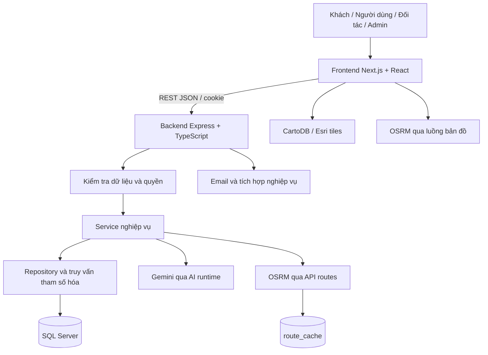
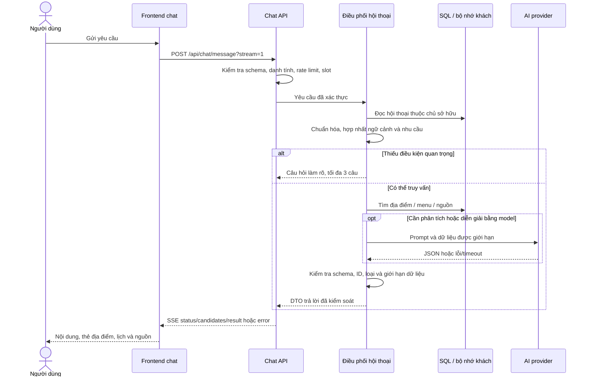
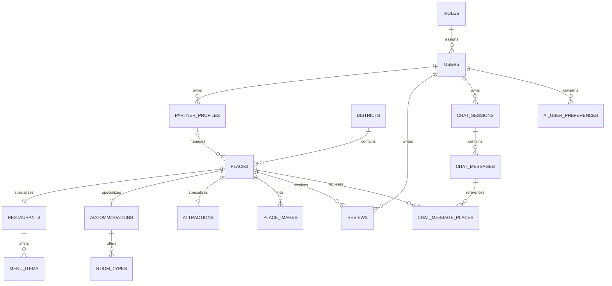
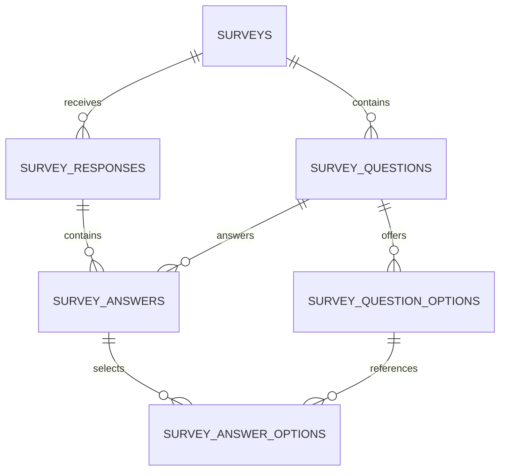
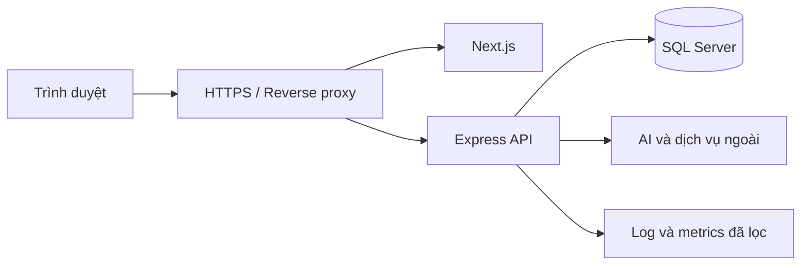

# TÀI LIỆU KIẾN TRÚC HỆ THỐNG DANANGGO SMART

## Thiết kế hệ thống – Thiết kế cơ sở dữ liệu – Thiết kế giải thuật

| Thuộc tính | Nội dung |
|---|---|
| Dự án | DaNangGo Smart – Hệ thống du lịch thông minh Đà Nẵng |
| Phiên bản tài liệu | 1.0 |
| Ngày biên soạn | 06/11/2026, múi giờ Việt Nam |
| Đối tượng đọc | Thành viên phát triển, người kiểm thử, người hướng dẫn và người đánh giá dự án |
| Căn cứ | Mã nguồn frontend/backend, schema SQL và các migration trong repository tại thời điểm biên soạn |
| Phạm vi | Kiến trúc toàn dự án, tập trung vào địa điểm, bản đồ, lịch trình, trợ lý Gô và khảo sát |

**Cách đọc:** “Hiện có” mô tả thành phần tìm thấy trong code; không đồng nghĩa đã vận hành đầy đủ trên production. “Đề xuất” mô tả thiết kế nâng cấp, chưa được coi là chức năng đã triển khai. Tài liệu không thay thế schema thực tế của từng môi trường hoặc đặc tả API chi tiết.

## Mục lục

1. [Mục tiêu và phạm vi](#1-mục-tiêu-và-phạm-vi)
2. [Thiết kế hệ thống](#2-thiết-kế-hệ-thống)
3. [Thiết kế cơ sở dữ liệu](#3-thiết-kế-cơ-sở-dữ-liệu)
4. [Thiết kế giải thuật](#4-thiết-kế-giải-thuật)
5. [Lộ trình nâng cấp trợ lý Gô](#5-lộ-trình-nâng-cấp-trợ-lý-gô)
6. [Kiểm thử và tiêu chí nghiệm thu](#6-kiểm-thử-và-tiêu-chí-nghiệm-thu)
7. [Triển khai và vận hành](#7-triển-khai-và-vận-hành)
8. [Tài liệu và mã nguồn tham chiếu](#8-tài-liệu-và-mã-nguồn-tham-chiếu)

## 1. Mục tiêu và phạm vi

### 1.1. Bài toán

Thông tin tham quan, ăn uống và lưu trú thường nằm ở nhiều nguồn. Du khách cần tìm nơi phù hợp ngân sách, biết cách di chuyển và ghép các lựa chọn thành lịch trình khả thi. Hệ thống cần phục vụ cả khách du lịch, đối tác cập nhật cơ sở và quản trị viên kiểm soát dữ liệu.

DaNangGo tập trung vào bốn kết quả:

- Tra cứu địa điểm và thông tin dịch vụ có cấu trúc.
- Lập, lưu và điều chỉnh lịch trình theo điều kiện chuyến đi.
- Xem địa điểm và tuyến đường ngay trong web.
- Tư vấn bằng Gô dựa trên dữ liệu hệ thống, phân biệt dữ kiện đã biết với thông tin cần xác nhận.

### 1.2. Tác nhân

| Tác nhân | Trách nhiệm và quyền chính |
|---|---|
| Khách chưa đăng nhập | Khám phá nội dung công khai, dùng bản đồ, chat trong phiên khách; gửi khảo sát theo điều kiện của biểu mẫu |
| Người dùng đăng nhập | Quản lý dữ liệu cá nhân được phép, lịch trình, yêu thích, hội thoại và sở thích đã đồng ý lưu |
| Đối tác | Quản lý cơ sở thuộc quyền sở hữu, nội dung dịch vụ và phản hồi theo luồng được hệ thống cho phép |
| Quản trị viên | Quản lý người dùng/đối tác, nội dung, đánh giá, khảo sát và các cấu hình nghiệp vụ |
| Dịch vụ ngoài | Cung cấp mô hình AI, bản đồ nền, định tuyến, email và tích hợp thanh toán theo module |

Không lấy vai trò, chủ sở hữu hoặc quyền quản trị từ JSON người dùng tự gửi. Backend xác định quyền qua middleware xác thực và điều kiện sở hữu trong truy vấn.

### 1.3. Nguyên tắc thiết kế

1. Database và các nguồn đã lưu là căn cứ dữ kiện; mô hình AI không phải cơ sở dữ liệu.
2. Không biến giá thiếu thành giá miễn phí, hoặc báo giá tham khảo thành xác nhận đặt chỗ.
3. Tách sở thích trong chuyến hiện tại khỏi sở thích lưu lâu dài có xác nhận.
4. Mỗi thay đổi lịch trình phải có phạm vi; giữ các phần không được yêu cầu sửa.
5. Khi dịch vụ ngoài lỗi, thông báo giới hạn và duy trì phần chức năng còn hoạt động.
6. Phát triển theo module trong một backend chung; chưa cần tách thành nhiều microservice.

## 2. Thiết kế hệ thống

### 2.1. Kiến trúc tổng thể

Kiến trúc hiện tại gồm frontend và backend tách ứng dụng, cùng cơ sở dữ liệu SQL Server. Backend tổ chức theo domain, tương ứng cách tiếp cận **modular monolith**.



Hai đường gọi OSRM có mục tiêu khác nhau: frontend phục vụ tuyến hiển thị trên bản đồ; backend phục vụ API lựa chọn phương tiện và cache tuyến. Không mặc định chúng dùng chung một cache hoặc luôn trả kết quả giống nhau.

### 2.2. Công nghệ

Các phiên bản dưới đây là khai báo trong `package.json`, không phải chứng nhận phiên bản đang chạy trên mọi môi trường.

| Lớp | Công nghệ | Vai trò |
|---|---|---|
| Frontend | Next.js 16.3.x, React 19.3.x, TypeScript | Giao diện và điều hướng ứng dụng |
| Giao diện | Tailwind CSS 4.x, CSS Modules, Lucide, Framer Motion | Thành phần, bố cục, biểu tượng và chuyển động |
| Bản đồ | Leaflet, React Leaflet | Marker, lớp nền, vòng bán kính và tuyến đường |
| Backend | Node.js, Express 5, TypeScript | API và điều phối nghiệp vụ |
| Validation | Zod | Kiểm tra đầu vào và đầu ra có cấu trúc |
| Database | SQL Server, driver `mssql` | Dữ liệu quan hệ, transaction và truy vấn |
| AI | SDK `@google/genai` | Trích ý định, diễn giải và các tác vụ AI theo schema |
| Bảo vệ API | Cookie, xác thực token, Helmet, CORS, kiểm tra nguồn CSRF, rate limit | Kiểm soát truy cập và yêu cầu |

### 2.3. Cấu trúc trách nhiệm

```text
frontend/
  app/                    Các trang và layout
  components/chat/        Trang chat, widget, lịch và phản hồi
  components/map/         Thành phần Leaflet
  contexts/               Trạng thái xác thực dùng chung
  lib/api/                Gọi API backend
  lib/map-navigation.ts   Xử lý điều hướng bản đồ
  types/                  Kiểu dữ liệu frontend

backend/src/
  index.ts                Khởi tạo Express và đăng ký router
  config/                 Kết nối SQL, cấu hình dịch vụ
  middleware/             Xác thực, quyền, CSRF, lỗi
  modules/                Domain nghiệp vụ
  Ai/promt.ts             Prompt, schema và builder cho từng công cụ
  Ai/go-policy.ts         Chính sách tư vấn chung của Gô
  Ai/runtime.ts           Gọi provider, cache, timeout và dự phòng
  scripts/                Migration, audit và kiểm thử tích hợp

database/
  schema/                 Schema nền
  migrations/             Thay đổi cấu trúc theo tính năng
  seeds/                  Các bộ dữ liệu có mục đích riêng
```

Luồng backend điển hình: **Router → validation/xác thực → service → repository → database**. Một số module dùng controller trung gian; không yêu cầu mọi module có cùng số lượng file.

### 2.4. Các phân hệ

| Phân hệ | Trách nhiệm | Nhóm API hiện có |
|---|---|---|
| Tài khoản | Đăng ký, đăng nhập, phiên, thông tin tài khoản | `/api/auth`, `/api/admin/auth` |
| Địa điểm | Danh sách, chi tiết, hình ảnh và phân loại | `/api/places`, `/api/categories` |
| Ẩm thực | Nhà hàng, menu và khẩu vị | `/api/restaurants`, `/api/menu-items` |
| Lưu trú | Cơ sở và loại phòng | `/api/accommodations` |
| Tham quan | Điểm đến và dữ liệu vé/thời lượng | `/api/attractions` |
| Lịch trình | Sinh, lưu và quản lý lịch | `/api/itineraries` |
| Gợi ý theo điều kiện | Lọc ngân sách, loại và danh mục | `/api/recommendations` |
| Gô | Hội thoại, lịch tư vấn, phản hồi, sở thích | `/api/chat`, `/api/ai` |
| Di chuyển | Lựa chọn phương tiện và ước tính tuyến | `/api/routes` |
| Đánh giá | Gửi/quản lý đánh giá theo quyền | `/api/reviews`, `/api/admin/reviews` |
| Khảo sát | Biểu mẫu, gửi câu trả lời và quản lý | `/api/surveys`, `/api/admin/surveys` |
| Đối tác | Quản lý cơ sở và các thao tác đối tác | `/api/partner` |
| Quản trị | Người dùng, đối tác, địa điểm, nội dung | `/api/admin/...` |
| Gói dịch vụ | Đăng ký gói và tích hợp liên quan | `/api/subscriptions`, `/api/webhooks/sepay` |

Có module hoặc bảng thanh toán/booking không đồng nghĩa trợ lý Gô được tự đặt phòng hoặc thực hiện giao dịch. Khả năng thực hiện phải được xác nhận ở từng luồng cụ thể.

### 2.5. Luồng tư vấn Gô



SSE được dùng để truyền trạng thái và kết quả; không hiển thị trực tiếp chuỗi JSON model chưa được kiểm tra. Frontend còn phải xử lý UTF-8 và ranh giới event khi mạng chia gói.

Hợp đồng hiện tại vẫn giữ cấu trúc:

```json
{
  "sessionId": 123,
  "message": {
    "id": "ma-tin-nhan-do-server-tao",
    "sender": "AI",
    "content": "Nội dung tư vấn",
    "intent": "SEARCH",
    "secondaryIntents": ["FOOD", "SIGHT"],
    "needsClarification": true,
    "questions": ["Bạn đi mấy người?"],
    "profileSuggestions": [],
    "sources": [],
    "warnings": []
  }
}
```

Đây là ví dụ cấu trúc rút gọn. `confirmedContext` và các trường `places`, `recommendationGroups`, `travelPlan`, `comparison` được dùng tùy kết quả; ID trong ví dụ không phải bản ghi để sử dụng thực tế.

### 2.6. Luồng bản đồ

1. Frontend lấy danh sách địa điểm có tọa độ hợp lệ.
2. Người dùng chọn bộ lọc và bán kính 2, 5 hoặc 10 km.
3. Tâm lọc là GPS được cấp quyền hoặc tâm Đà Nẵng dự phòng `[16.0544, 108.2022]`.
4. Chọn “Chỉ đường” để lấy điểm xuất phát và đích, gọi dịch vụ tuyến.
5. Đổi GeoJSON `[lng, lat]` thành tọa độ Leaflet `[lat, lng]` và vẽ polyline.
6. Hiển thị km/phút ước tính; giữ liên kết Google Maps dự phòng như thao tác phụ do người dùng lựa chọn.

Tâm thành phố dự phòng phải được ghi nhãn; không gọi đó là vị trí thật của khách. Bán kính đường chim bay và chiều dài tuyến đường là hai đại lượng khác nhau.

### 2.7. Luồng khảo sát phục vụ AI

1. Người dùng mở khảo sát và nhập các câu trả lời phù hợp loại câu hỏi.
2. Backend kiểm tra câu hỏi, phương án, điều kiện bắt buộc và đồng ý gửi.
3. Yêu cầu được ghi trong transaction, sử dụng mã yêu cầu để kiểm soát gửi lặp.
4. Quản trị viên xem kết quả tổng hợp theo quyền.
5. Chức năng AI phân tích nội dung chữ đã được xử lý thông tin cá nhân; thống kê số lượng/tỷ lệ do SQL hoặc code tính.

Khảo sát tổng thể, đánh giá một địa điểm và phản hồi câu trả lời chatbot là các nguồn khác nhau. Không nhập chung thang NPS với điểm sao hoặc coi người chưa sử dụng dịch vụ là điểm 0.

### 2.8. Giới hạn và trạng thái lỗi

| Trường hợp | Hành vi kiến trúc |
|---|---|
| Model hết quota hoặc lỗi | Runtime ghi mã lỗi đã lọc, có cooldown; service dùng quy tắc/DB khi có thể |
| Database chưa truy cập được | Trả lỗi phù hợp; không báo danh sách rỗng hoặc lưu thành công giả |
| Chưa có dữ liệu live | Nêu rõ chưa xác nhận thời tiết/sự kiện/tồn phòng/vé |
| Từ chối GPS | Cho phép chọn khu vực/điểm xuất phát hoặc dùng tâm dự phòng được ghi nhãn |
| OSRM lỗi | Báo chưa lấy được tuyến; không tự vẽ đường thẳng thành đường đi thực tế |
| Nhiều mục cùng khớp khi chỉnh lịch | Hỏi rõ địa điểm/ngày/buổi; chưa thay đổi lịch |
| Giá hoặc thành phần chưa rõ | Giữ trạng thái chưa biết; không mặc định miễn phí hoặc an toàn dị ứng |

## 3. Thiết kế cơ sở dữ liệu

### 3.1. Mô hình lưu trữ

SQL Server là hệ quản trị cơ sở dữ liệu quan hệ chính. Thiết kế dùng bảng quan hệ cho định danh, quyền sở hữu và liên kết nghiệp vụ; một số dữ liệu linh hoạt được lưu JSON kèm kiểm tra `ISJSON`.

Schema nền cần đọc cùng các migration. Ví dụ `chat_messages.dto_json`, các bảng nguồn công khai và sở thích AI được bổ sung sau schema nền. Tài liệu này mô tả các bảng chính, không liệt kê toàn bộ cột hoặc khẳng định mọi môi trường đã chạy đủ migration.

### 3.2. Nhóm người dùng và quyền

| Bảng | Khóa và liên kết chính | Mục đích |
|---|---|---|
| `dbo.roles` | `role_id` | Danh mục vai trò |
| `dbo.users` | PK `user_id`; FK `role_id` | Tài khoản, hồ sơ và trạng thái |
| `dbo.partner_profiles` | PK `partner_id`; liên kết `user_id` | Hồ sơ đối tác và luồng phê duyệt |
| `dbo.user_preferences` | Liên kết người dùng và danh mục | Sở thích nghiệp vụ của mô hình dữ liệu nền |
| `dbo.user_itinerary_preferences` | PK/FK `user_id` | Sở thích cho công cụ lập lịch |
| `dbo.ai_user_preferences` | PK ghép `(user_id, preference_key)` | Sở thích Gô có nguồn đồng ý lưu |

Các bảng sở thích phục vụ các luồng khác nhau; không tự đồng nhất hoặc ghi đè lẫn nhau. Mật khẩu lưu dạng hash theo luồng xác thực, không đưa vào ngữ cảnh AI.

### 3.3. Nhóm địa điểm

| Bảng | Khóa và liên kết chính | Dữ liệu tiêu biểu |
|---|---|---|
| `dbo.places` | PK `place_id`; FK quận/đối tác | Tên, loại, địa chỉ, tọa độ, trạng thái, thống kê |
| `dbo.districts` | PK `district_id` | Danh mục khu vực |
| `dbo.place_images` | PK `image_id`; FK `place_id` | Hình và ảnh đại diện |
| `dbo.opening_hours` | FK `place_id` | Giờ theo cấu trúc hiện có |
| `dbo.restaurants` | PK `place_id`, liên kết địa điểm cùng loại | Nhà hàng và loại ẩm thực |
| `dbo.menu_items` | PK `menu_item_id`; liên kết nhà hàng | Tên món, mô tả, giá, ảnh và khả dụng |
| `dbo.tastes`, `dbo.menu_item_tastes` | Bảng danh mục và bảng nối | Nhãn khẩu vị |
| `dbo.accommodations` | PK `place_id`, liên kết địa điểm cùng loại | Loại lưu trú, số sao, nhận/trả phòng |
| `dbo.room_types` | PK `room_type_id`; liên kết lưu trú | Loại phòng, giá catalog và sức chứa |
| `dbo.amenities`, `dbo.accommodation_amenities` | Danh mục và bảng nối | Tiện nghi trong dữ liệu nghiệp vụ |
| `dbo.attractions` | PK `place_id`, liên kết địa điểm cùng loại | Giá vé và thời lượng tham quan |
| `dbo.cuisines`, `dbo.attraction_categories` | Danh mục | Phân loại ẩm thực và điểm tham quan |

Có bảng tiện nghi không đồng nghĩa Gô đã truy vấn hoặc xác minh đủ từng tiêu chí. Giá loại phòng không đại diện cho tồn phòng theo ngày. `is_available` của món trong catalog không chứng minh quán đang phục vụ tại thời điểm khách hỏi.

### 3.4. Sơ đồ quan hệ địa điểm và hội thoại



Tên viết hoa trong sơ đồ tương ứng bảng `dbo` cùng tên dạng chữ thường. Đây là ERD rút gọn để giải thích các quan hệ chính; các điều kiện nullable/unique và cardinality chính xác phải kiểm tra trong schema cùng migration. Ví dụ hồ sơ đối tác của một tài khoản còn chịu các ràng buộc nghiệp vụ riêng.

### 3.5. Hội thoại và nguồn dữ liệu AI

| Bảng | Vai trò | Lưu ý |
|---|---|---|
| `dbo.chat_sessions` | Phiên hội thoại của tài khoản | Kiểm tra chủ sở hữu trước khi đọc/ghi |
| `dbo.chat_messages` | Nội dung và DTO JSON bổ sung | DTO phục vụ hiển thị lại lịch/thẻ/metadata |
| `dbo.chat_message_places` | Liên kết tin nhắn và địa điểm | Không dùng ID do model tự tạo |
| `dbo.public_place_provenance` | Nguồn công khai theo địa điểm | `facts_json`, ngày cập nhật |
| `dbo.public_stay_details` | Dữ kiện lưu trú có nguồn | Tách khỏi dữ liệu tồn phòng/booking |
| `dbo.public_catalog_change_log` | Dấu vết thay đổi catalog | Batch, địa điểm, trạng thái và lý do |
| `dbo.ai_place_vectors` | Dữ liệu embedding khi tính năng được sử dụng | Không phải bằng chứng thông tin đã được xác minh |

Bảng embedding được chuẩn bị trong migration runner AI. Sự tồn tại của bảng hoặc mã tích hợp không chứng minh tất cả truy vấn hiện đều dùng semantic retrieval.

Khách chưa đăng nhập dùng bộ nhớ phiên có giới hạn và thời hạn trong tiến trình backend, không tự ghi lịch sử khách thành hồ sơ SQL lâu dài. Khi backend khởi động lại, phiên khách có thể mất. Muốn chia sẻ phiên giữa nhiều instance cần thiết kế kho phiên chung.

### 3.6. Sở thích có xác nhận

Cấu trúc `dbo.ai_user_preferences` theo migration 018:

| Cột | Kiểu | Ràng buộc/trách nhiệm |
|---|---|---|
| `user_id` | `INT` | FK tới `users.user_id` |
| `preference_key` | `VARCHAR(40)` | Khóa thuộc danh sách cho phép ở tầng ứng dụng |
| `consent_source` | `VARCHAR(20)` | CHECK: `CHAT_EXPLICIT` hoặc `UI_CONFIRM` |
| `consented_at` | `DATETIME2` | Thời điểm xác nhận |
| `updated_at` | `DATETIME2` | Thời điểm cập nhật |

Khóa chính ghép ngăn lặp một ưu tiên của cùng tài khoản. Thay một ưu tiên đối nghịch được thực hiện trong transaction. Ví dụ người dùng đồng ý lưu “không ăn cay” thì ưu tiên “thích ăn cay” được xử lý theo quy tắc đối nghịch hiện có.

Không lưu đoạn hội thoại tùy ý vào bảng này. Điều kiện dị ứng phải được người dùng nói rõ, có đề nghị/xác nhận nếu lưu lâu dài; không suy đoán bệnh lý hoặc thu nhập. Xóa sở thích đã lưu và xóa lịch sử hội thoại là hai thao tác khác nhau.

### 3.7. Hai mô hình lịch trình cần phân biệt

Repository tồn tại schema lịch trình nền `dbo` và namespace `planner` được migration 013 hỗ trợ. Không coi mọi bảng cùng chữ “itinerary” là cùng một mô hình.

| Mô hình | Thành phần | Mục đích |
|---|---|---|
| Schema nền | `dbo.itineraries`, `itinerary_days`, `itinerary_items`, `itinerary_alternatives` | Mô hình quan hệ lịch trình nền |
| Công cụ lập lịch | `planner.itineraries`, `planner.itinerary_items`, `planner.itinerary_budgets` | Lưu đầu vào, mục lịch và tổng hợp ngân sách của luồng planner |
| Catalog lập lịch | `dbo.itinerary_catalog_places`, `dbo.itinerary_catalog_preferences` | Dữ liệu/nhãn phục vụ sinh lịch |
| Snapshot đầu vào/đầu ra | `planner.itinerary_training_data` | Lưu snapshot nếu luồng tương ứng dùng; không tự đồng nghĩa đã huấn luyện model |

Migration có thể tạo bảng `planner` riêng hoặc view trỏ tới bảng tương thích, tùy cấu trúc đã tồn tại. Cần kiểm tra loại object khi triển khai. Lịch gợi ý trong chat được lưu cùng DTO hội thoại; thao tác lưu lịch đi qua bộ chuyển đổi và luồng planner, không tự coi mỗi tin nhắn là một booking.

Các ràng buộc quan trọng ở mô hình planner được tạo riêng:

- Số ngày trong phạm vi 1–3; số khách dương.
- Mỗi `item_key` duy nhất trong lịch.
- Thứ tự mục duy nhất theo lịch/ngày.
- Giá và số lượng hợp lệ.
- Tổng chi phí bằng tổng các nhóm chi phí lưu trữ.
- Ngân sách còn lại bằng ngân sách đầu vào trừ tổng dự kiến.
- Các trường JSON có kiểm tra hợp lệ.

### 3.8. Khảo sát và đánh giá



Migration 015 bổ sung mã câu hỏi/phương án, loại câu trả lời, số lựa chọn tối đa, `request_id`, `payload_hash`, `consent_agreed`, giá trị số và bảng nối đa lựa chọn. `survey_responses.user_id` được phép null để hỗ trợ trường hợp khảo sát ẩn danh theo luồng hiện có.

Đánh giá địa điểm dùng `reviews` và các phần mở rộng như ảnh/audit/cooldown. Cần phân biệt:

- Điểm sao của đánh giá: thang 1–5 theo luồng đánh giá.
- NPS của khảo sát: thang 0–10 khi câu hỏi quy định như vậy.
- Nội dung chữ: chỉ tổng hợp khi có dữ liệu thật và đủ điều kiện.

### 3.9. Toàn vẹn, chỉ mục và migration

**Hiện có:** khóa chính, khóa ngoại, một số unique/check constraint, chỉ mục trong schema/migration; truy vấn dùng tham số hóa. Request khảo sát có unique index trên `request_id` khi có giá trị để hỗ trợ chống gửi lặp.

**Đề xuất cần đo bằng execution plan:**

| Truy vấn thường gặp | Hướng tối ưu cần đánh giá |
|---|---|
| Danh sách nơi ACTIVE theo loại/quận | Chỉ mục phù hợp trên loại, trạng thái và quận |
| Tin nhắn thuộc phiên | Chỉ mục theo phiên và thứ tự tin nhắn |
| Đánh giá được duyệt của cơ sở | Chỉ mục theo địa điểm, trạng thái và thời gian |
| Menu đang khả dụng | Chỉ mục theo địa điểm và khả dụng |
| Tìm gần tọa độ trên dữ liệu lớn | Cột geography/chỉ mục không gian hoặc bước lọc vùng trước |

Không khẳng định các chỉ mục đề xuất đã tồn tại hoặc đã cải thiện tốc độ nếu chưa đo. Các migration có một số tiền tố số trùng nhau; không suy thứ tự phụ thuộc chỉ từ số ở tên file. Dùng runner/manifest phù hợp với từng tính năng và kiểm tra object trước khi thay đổi môi trường.

## 4. Thiết kế giải thuật

### 4.1. Phân tích ý định và giữ ngữ cảnh

**Đầu vào:** tin nhắn, lịch sử thuộc người dùng, trạng thái đã xác nhận và sở thích được phép dùng.

**Đầu ra:** ý định chính, các nhóm nhu cầu, điều kiện chuyến đi, câu hỏi làm rõ và dữ liệu để truy vấn.

```text
NHẬN_YÊU_CẦU(message, owner):
    kiểm tra định dạng, quyền và quyền sở hữu hội thoại
    chuẩn hóa cách viết phổ biến, tiền và thời gian
    nếu người dùng yêu cầu bắt đầu lại:
        bỏ điều kiện chuyến cũ
    nếu không:
        giữ thông tin đã xác nhận, cập nhật phần vừa thay đổi
    phân tích đủ nhu cầu food / sight / stay
    xử lý lệnh hồ sơ theo xác nhận và danh tính
    nếu thiếu điều kiện ảnh hưởng quyết định:
        hỏi tối đa 3 câu
    nếu có thể truy vấn:
        tìm dữ liệu đúng loại, điều kiện và loại trừ
    chỉ dùng model cho công cụ cần thiết khi provider khả dụng
    kiểm tra kết quả trước khi trả về
```

Ví dụ “có 4 triệu, muốn đi ăn và tham quan” phải giữ cả hai nhu cầu. “Quán ăn gần khách sạn” là tìm quán, trong đó khách sạn là điểm mốc. Không thay tổng tiền chuyến bằng hạn mức của từng món.

Khi model không khả dụng, quy tắc không thể bảo đảm hiểu mọi lỗi chính tả hoặc cách nói mới. Cần làm rõ thay vì âm thầm coi câu chưa hiểu là một nhu cầu khác.

### 4.2. Truy xuất và kiểm tra gợi ý

1. Lọc cơ sở công khai phù hợp, đặc biệt trạng thái `ACTIVE` trong luồng gợi ý.
2. Lọc loại, quận, ngân sách với đơn vị phù hợp, tên món/địa điểm và điều kiện loại trừ.
3. Đọc giá menu hoặc loại phòng từ nguồn tương ứng; giữ null khi chưa biết.
4. Sắp xếp theo quy tắc của endpoint, chẳng hạn rating/review count và khóa phụ ổn định; một số nhánh ưu tiên giá hoặc khoảng cách.
5. Chỉ cho model chọn ID thuộc tập đã truy xuất.
6. Lọc lại ID, loại và các điều kiện trước khi dựng thẻ.

Đây là truy xuất dữ liệu kết hợp quy tắc và model trong các nhánh có sử dụng, không phải bằng chứng đã có hệ thống học sở thích từ toàn bộ hành vi người dùng.

**Tên món ngắn:** “lẩu”, “chè”, “kem” phải tránh khớp nhầm “lâu đời”, “chế biến”, “kèm”. Bộ lọc món sử dụng kiểm tra ranh giới từ và giữ dấu cho các từ ngắn theo cách cài đặt hiện tại. Tên món/giá hiển thị phải có trong dữ liệu menu; có tên món vẫn không đủ để chứng nhận thành phần an toàn cho dị ứng.

### 4.3. Lọc bán kính Haversine

Với hai điểm có vĩ độ/kinh độ tính bằng radian:

```text
a = sin²((lat2 - lat1) / 2)
    + cos(lat1) × cos(lat2) × sin²((lng2 - lng1) / 2)
c = 2 × atan2(√a, √(1 - a))
d = R × c, với R xấp xỉ 6371 km
```

```text
LỌC_BÁN_KÍNH(locations, center, radius):
    với mỗi địa điểm có tọa độ hợp lệ:
        tính khoảng cách Haversine đến center
        giữ nếu khoảng cách <= radius và thỏa bộ lọc
    sắp xếp theo khoảng cách nếu luồng yêu cầu
```

Với N địa điểm, bước tính và lọc tuyến tính theo N; nếu sắp xếp toàn bộ kết quả, chi phí sắp xếp là O(N log N). Đây là đánh giá thuật toán trong bộ nhớ, chưa bao gồm truy vấn SQL, tải mạng hoặc chi phí hiển thị.

### 4.4. Chỉ đường trong web

Luồng bản đồ dùng API định tuyến dạng:

```text
/route/v1/driving/{lng1},{lat1};{lng2},{lat2}
    ?overview=full&geometries=geojson
```

Các bước chính:

1. Kiểm tra đầu/đích và loại bỏ yêu cầu cũ khi người dùng đổi đích nếu luồng hỗ trợ hủy.
2. Gửi yêu cầu có timeout và xử lý trạng thái không có tuyến.
3. Đọc geometry, distance và duration.
4. Đổi thứ tự tọa độ cho Leaflet, vẽ tuyến và điều chỉnh khung nhìn.
5. Đổi mét thành km và giây thành phút khi hiển thị.

Trong backend `travel.service.ts`, tuyến driving là cơ sở để suy ra ước tính cho nhiều phương tiện. Ví dụ đi bộ được ước tính theo tốc độ, các phương tiện khác theo hệ số và chi phí cấu hình. **Không mô tả đây là định tuyến đi bộ/xe buýt chuyên biệt hoặc giá cước live.** Cache backend có TTL quy định trong code; không thay thế dữ liệu giao thông thời gian thực.

### 4.5. Sinh lịch ở công cụ lập lịch

Luồng `itineraries.service.ts` dùng catalog và quy tắc để chọn/xếp mục, không phải mô hình tự do viết lịch rồi ghi thẳng DB.

1. Kiểm tra đầu vào và nhu cầu lưu trú/ăn uống/tham quan/giải trí.
2. Chọn hoặc kiểm tra các lựa chọn cố định theo ngân sách và loại.
3. Tính chi phí cố định và khoản dự phòng.
4. Tạo pool tham quan ưu tiên theo sở thích, sắp xếp theo giá trong các bước tương ứng.
5. Phân bổ ngân sách còn lại theo nhóm và theo ngày.
6. Chọn mục phù hợp, hạn chế lặp, kiểm tra khả năng xếp theo giờ.
7. Tạo các ngày và sắp xếp mục theo thời gian.
8. Tính tổng dự kiến, khoản còn lại/vượt và thông báo thiếu điều kiện.

Trong phiên bản code đối chiếu, công cụ này dùng cấu hình dự phòng 8% và dự trù di chuyển nội đô 80.000đ/người/ngày. Đây là **tham số ước tính của giải thuật**, không phải báo giá nhà xe hoặc mức chi áp dụng cho mọi khách. Không coi các hằng số đó là công thức dùng chung cho lịch tư vấn trong chat.

Cách chọn hiện tại là heuristic dựa trên lọc, ưu tiên và phân bổ ngân sách. Không khẳng định tìm được phương án tối ưu toàn cục hoặc đã giải bài toán TSP/VRP.

### 4.6. Sinh lịch tư vấn trong chat

Luồng chat dùng `chat.advisor.ts`, `chat.budget.ts`, `chat.trip-preferences.ts` và service điều phối. Cần xử lý:

- Sáng, trưa, chiều, tối; thời gian nghỉ và giới hạn giờ đến/về.
- Tổng khách, người lớn/trẻ em và dữ liệu tuổi đã cung cấp.
- Có/không cần nơi ở, số đêm hoặc nhu cầu nghỉ ban ngày.
- Phương tiện, mức vận động, điểm muốn tránh.
- Giá đã có, khoản ăn uống dự kiến, dự phòng và các chi phí chưa xác định.

Ví dụ khách đến 18:30 thì không được xếp bữa sáng cùng ngày như hoạt động có thể thực hiện. Nếu chỉ còn thời gian đến nơi và nghỉ, lịch cần thể hiện điều đó.

Phạm vi sinh lịch chi tiết hiện tại là 1–3 ngày. Yêu cầu ngoài phạm vi phải được thông báo hoặc làm rõ, không tự đổi số ngày. Một lịch chưa có giờ đến/về có thể là bản nháp có giả định/câu hỏi; không gọi nó là lịch đã được khách xác nhận toàn bộ.

### 4.7. Tính ngân sách và độ chắc chắn

```text
Ngân sách tổng = số tiền đã xác nhận theo phạm vi phù hợp

Nếu mỗi người: cần số khách để quy đổi
Nếu mỗi ngày: cần số ngày để quy đổi
Nếu mỗi phòng/đêm: cần số phòng, số đêm và điều kiện áp dụng
```

Không tự nhân giá người lớn cho trẻ em khi thiếu chính sách. Giá một món không phải hóa đơn cả bữa; giá một phòng không tự đại diện cho đủ phòng cho cả nhóm.

Nên trình bày các đại lượng riêng:

```text
Cộng khoản đã có giá = tổng những khoản có đủ căn cứ để tính
Tổng dự kiến = các khoản đã biết + các khoản dự trù được ghi nhãn
Khoản còn lại theo kịch bản = ngân sách - các khoản đang xét
```

Nếu một khoản chưa biết giá, không đổi null thành 0 chỉ để làm tổng có vẻ đầy đủ. “Cộng khoản đã có giá” và “tiền đã chi thực tế” là hai khái niệm khác nhau. Có tiền còn lại sau các khoản đã biết chưa chứng minh đủ chi phí toàn chuyến.

### 4.8. Chỉnh lịch có phạm vi

```text
CHỈNH_LỊCH(plan, command):
    xác định thao tác: thêm / bỏ / thay / chuyển / đổi điều kiện
    xác định mục, ngày, buổi và phần yêu cầu giữ nguyên
    nếu không xác định duy nhất:
        hỏi lại, giữ nguyên plan
    tạo bản sao của lịch
    kiểm tra điều kiện loại trừ, thời gian và dữ liệu thay thế
    áp dụng thay đổi trong phạm vi được chỉ định
    tính lại khoản chi bị ảnh hưởng và kiểm tra lịch
    trả lịch mới kèm phiên bản, không sửa ngầm lịch gốc
```

Mã mục ổn định giúp tham chiếu chính xác qua nhiều lượt. Khi “giữ nguyên ngày 1, sửa ngày 2”, kiểm thử cần so sánh nội dung ngày 1 trước/sau, không chỉ kiểm tra rằng backend trả HTTP thành công.

### 4.9. Ghi nhớ sở thích

1. Nhận biết ưu tiên nói rõ, chỉ trong danh sách khóa cho phép.
2. Dùng điều kiện mới của phiên cho chuyến hiện tại.
3. Nếu đề nghị lưu lâu dài, hiển thị nội dung cần đồng ý.
4. Chỉ ghi sau lệnh lưu rõ ràng hoặc nút đồng ý hợp lệ.
5. Backend lấy user ID từ phiên xác thực, ghi nguồn và thời điểm đồng ý.
6. Lệnh xác nhận ngắn chỉ có nghĩa khi có đề nghị đang chờ.
7. Khách chưa đăng nhập không được báo đã lưu hồ sơ lâu dài.
8. Khi xóa, chỉ tác động đúng tài khoản và đúng loại dữ liệu.

Ưu tiên hiện tại có thể khác sở thích đã lưu. Ví dụ thường thích cay nhưng chuyến này muốn thanh đạm thì dùng yêu cầu hiện tại; không tự thay hồ sơ lâu dài khi chưa được đồng ý.

### 4.10. Khảo sát và thống kê

Đầu vào gửi khảo sát được kiểm tra theo schema câu hỏi thực tế:

- Câu hỏi phải thuộc khảo sát; phương án phải thuộc câu hỏi.
- Không chấp nhận lựa chọn trùng hoặc tổ hợp loại trừ lẫn nhau.
- Số nằm trong thang quy định; số 0 hợp lệ của NPS phải được giữ nguyên.
- Request gửi lại cùng mã cần được đối chiếu nội dung để tránh ghi hai lần hoặc nhận nhầm nội dung mới là bản cũ.

AI chỉ gom nhóm nội dung và diễn giải. Công thức NPS, khi có đủ câu trả lời NPS hợp lệ:

```text
NPS = 100 × (số người chấm 9–10 - số người chấm 0–6)
            / tổng số câu trả lời NPS hợp lệ
```

Công thức trên là đặc tả tính toán cho loại câu hỏi NPS, không phải xác nhận mọi màn hình hiện đều hiển thị chỉ số này. Nếu mẫu số bằng 0 thì trạng thái là chưa có dữ liệu, không phải NPS bằng 0.

### 4.11. Xếp hạng nâng cao – đề xuất

Có thể thiết kế điểm gợi ý cá nhân hóa:

```text
S = w1 × độ khớp sở thích
  + w2 × độ phù hợp ngân sách
  + w3 × độ thuận tiện di chuyển
  + w4 × độ tin cậy dữ liệu
  + w5 × độ phù hợp thời gian
```

Các trọng số và cách chuẩn hóa cần được thử nghiệm trên tập đánh giá, chưa phải công thức đang vận hành. Điều kiện bắt buộc phải lọc trước: cơ sở không công khai, không đủ thời gian hoặc thiếu căn cứ an toàn không được “bù điểm” bằng rating cao.

Một hệ thống xếp hạng tốt cần giải thích vì sao chọn, cho phép phản hồi và theo dõi kết quả; không chỉ tối ưu lượt bấm.

## 5. Lộ trình nâng cấp trợ lý Gô

Các nội dung dưới đây là **đề xuất phát triển**, không phải xác nhận đã hoàn thành.

| Ưu tiên | Hạng mục | Dữ liệu/API cần có | Kết quả mong muốn |
|---|---|---|---|
| 1 | Ổn định provider AI | Quota, timeout, mã lỗi, giám sát và khả năng truy cập | Phân biệt model live với dự phòng; giảm gián đoạn |
| 2 | Làm sâu dữ liệu cơ sở | Menu, giá theo đơn vị, thành phần, tiện nghi, chính sách, nguồn/ngày kiểm tra | Giảm câu trả lời thiếu dữ liệu |
| 3 | Hồ sơ chuyến đi có cấu trúc | Điều kiện đã xác nhận và lịch sử chỉnh sửa | Hỏi ít hơn, không quên yêu cầu |
| 4 | Tư vấn có lý do và đánh đổi | Các yếu tố chọn, khoản thiếu, phương án thay thế | Khách hiểu vì sao gợi ý phù hợp |
| 5 | Ba phương án cho cùng yêu cầu | Cùng đầu vào, ràng buộc chung và cách xếp hạng | Tiết kiệm, cân bằng, thoải mái để khách so sánh |
| 6 | Lịch dựa trên tuyến | Ma trận thời gian đi lại, giờ hoạt động có nguồn, khoảng đệm | Giảm lịch quá dày hoặc xa nhau |
| 7 | Đồng hành trong chuyến | Tiến độ do khách xác nhận, API thời tiết nếu có | Điều chỉnh phần còn lại khi đến muộn hoặc mưa |
| 8 | Học từ phản hồi có phép | Lý do không phù hợp và xác nhận lưu | Cá nhân hóa có kiểm soát |
| 9 | Đánh giá chất lượng liên tục | Case hồi quy, đánh giá live và đánh giá thủ công | Theo dõi chất lượng qua từng phiên bản |

### 5.1. Mở rộng dữ liệu – đề xuất

Nên ưu tiên dữ liệu có cấu trúc trước khi tăng độ dài prompt:

- Dữ kiện món ăn: định danh món, đơn vị giá, khẩu phần, thành phần do cơ sở xác nhận, thời điểm kiểm tra.
- Báo giá lưu trú: loại phòng, ngày áp dụng, số khách, phụ phí và nguồn; tồn phòng là dữ liệu/API riêng.
- Ràng buộc tham quan: thời lượng, vận động, khả năng tiếp cận và điều kiện sử dụng được xác minh.
- Dữ kiện chuyến đi: trường đã xác nhận, trường còn thiếu, nguồn của từng thay đổi.
- Thời gian di chuyển: điểm đầu/đích, phương tiện thực sự hỗ trợ, thời điểm và độ cũ của kết quả.

Có thể dùng bảng chuyên biệt hoặc mở rộng cấu trúc nguồn hiện tại sau khi chốt nghiệp vụ. Không tạo thêm bảng trùng công dụng với dữ liệu đã có chỉ vì tên khác nhau.

### 5.2. Độ tin cậy theo từng dữ kiện – đề xuất

Một dữ kiện nên có: nội dung/giá trị, đơn vị, nguồn, thời điểm đối chiếu, khoảng hiệu lực nếu có và trạng thái cần xác nhận lại. Không gộp tất cả thành một cờ “địa điểm đã xác minh”, vì giá phòng có thể hết hạn trong khi địa chỉ vẫn đúng.

### 5.3. Kiến trúc tối ưu tuyến – đề xuất

1. Tạo tập ứng viên đáp ứng điều kiện bắt buộc.
2. Lấy ma trận thời gian di chuyển từ dịch vụ phù hợp.
3. Ghép hoạt động vào cửa sổ thời gian và giờ hoạt động.
4. Tối ưu tổng thời gian/chi phí với giới hạn số điểm, thời gian nghỉ và ngân sách.
5. Khi thay một mục, chỉ tối ưu lại vùng lịch bị ảnh hưởng và giải thích thay đổi.

Có thể bắt đầu từ heuristic chèn điểm rồi cải thiện cục bộ. Chỉ chọn solver phức tạp hơn khi có dữ liệu và số lượng điểm đủ để chứng minh lợi ích. Chưa coi đây là tính năng đã triển khai của planner hiện tại.

## 6. Kiểm thử và tiêu chí nghiệm thu

### 6.1. Các lớp kiểm thử

| Lớp | Nội dung |
|---|---|
| Unit | Tiền, ngày, Haversine, từ món, sở thích, sửa lịch và công thức |
| Hợp đồng prompt | Schema JSON, vai trò công cụ, không đổi yêu cầu ngoài phạm vi |
| API/quyền | Guest, user, partner, admin; giả user ID; đọc dữ liệu khác chủ |
| SQL tích hợp | Bản ghi thực, ID/menu đúng, transaction và rollback |
| Hội thoại nhiều lượt | Giữ điều kiện, thay phạm vi nhỏ, reset và ngữ cảnh so sánh |
| Frontend | SSE, lỗi mạng, trạng thái rỗng, render và dữ liệu nguồn |
| Provider live | Khả dụng, schema và ngữ nghĩa của model thực |
| Thủ công | Tính hữu ích, lời văn, độ khả thi của chuyến và khả năng hiểu phương án |

### 6.2. Tiêu chí trọng tâm

- Câu có nhiều nhu cầu không mất một nhóm khi trả lời.
- Câu hỏi “gần khách sạn” không bị chuyển thành tìm khách sạn.
- Không có ID/giá/món được model tự bịa trong thẻ.
- Không quá ba câu làm rõ trong một lượt theo luồng đã quy định.
- Sửa ngày 2 không thay ngày 1 được yêu cầu giữ nguyên.
- Ngày/giờ không hợp lệ không tạo thành lịch có vẻ thực hiện được.
- Không báo lưu/xóa hồ sơ thành công khi DB lỗi.
- Không có truy cập hội thoại hoặc sở thích của tài khoản khác.
- Dự phòng khi provider lỗi không được tính là kết quả live đạt.
- Không trộn dữ liệu mẫu với dữ kiện phục vụ khách.

### 6.3. Bằng chứng kiểm thử đã lưu

Theo báo cáo kiểm thử ngày 05/11/2026 đã lưu trong repository: 423 câu tham chiếu có kết quả từng dòng; các suite backend/frontend và tích hợp có báo cáo riêng. Đây là bằng chứng lịch sử tại phiên bản đã kiểm tra, không phải kết quả chạy lại ngày 06/11/2026 khi biên soạn tài liệu này.

Các trạng thái cần phân biệt: PASS, DATA_LIMIT, GAP/FAIL và PROVIDER_UNAVAILABLE. Không gọi DATA_LIMIT là đã đáp ứng đầy đủ yêu cầu, và không dùng số lượng test để kết luận trợ lý đã hiểu mọi câu hỏi.

## 7. Triển khai và vận hành

### 7.1. Mô hình triển khai

Hiện có thể chạy frontend, backend và SQL Server thành các tiến trình/dịch vụ riêng. Cổng frontend/API cấu hình theo môi trường; không hard-code cổng localhost dùng thử thành cấu hình production.

Đề xuất production:



Sơ đồ production là mô hình đề xuất; không khẳng định đã có reverse proxy hoặc hệ thống giám sát được triển khai.

### 7.2. Cấu hình và bảo mật

- API key model, DB password và bí mật token chỉ nằm ở môi trường backend; không đưa vào biến public của frontend.
- CORS và kiểm tra nguồn yêu cầu khớp frontend được phép.
- Các route nhạy cảm kiểm tra xác thực, vai trò và sở hữu đối tượng.
- Query SQL nhận tham số, không ghép trực tiếp chuỗi người dùng thành SQL.
- Cookie, HTTPS và cấu hình chứng chỉ SQL được kiểm tra theo môi trường thật.
- Log chỉ giữ mã lỗi/thời điểm cần thiết; không ghi key, nội dung nhạy cảm hoặc raw lỗi SDK không được lọc.
- Khảo sát ẩn danh và sở thích dị ứng có mục đích/đồng ý riêng; hạn chế dữ liệu gửi model.

### 7.3. Đồng thời và cache

Chat hiện có giới hạn yêu cầu đồng thời, rate limit, timeout và cache/cooldown trong các thành phần tương ứng. Các map trong RAM chỉ bảo vệ tiến trình đang giữ chúng.

Khi tăng số instance, cần thiết kế kho phiên/cache/rate limit dùng chung và khóa đồng thời phù hợp. Nếu chỉ nhân bản backend mà không đổi thiết kế này, phiên khách và giới hạn đang chạy có thể không nhất quán giữa các instance.

### 7.4. Chỉ số vận hành – đề xuất

| Chỉ số | Mục đích |
|---|---|
| Thời gian phản hồi p50/p95 | Tách thời gian SQL, provider và xử lý nghiệp vụ |
| Tỷ lệ provider thành công/dự phòng | Phát hiện quota và lỗi truy cập |
| Tỷ lệ DATA_LIMIT theo nhóm | Ưu tiên bổ sung dữ liệu có ích |
| Tỷ lệ hỏi lại điều đã biết | Đánh giá giữ ngữ cảnh |
| Tỷ lệ sửa nhầm ngoài phạm vi | Đánh giá độ an toàn chỉnh lịch |
| Tỷ lệ dữ kiện quá hạn | Điều phối việc xác minh lại |
| Lỗi tuyến và tỷ lệ cache hit | Theo dõi chất lượng bản đồ |

Chưa đặt SLA hoặc công bố ngưỡng độ trễ đã đạt nếu chưa có đo tải. Sao lưu SQL và kiểm tra phục hồi, kiểm tra migration trên bản sao dữ liệu, cùng kế hoạch rollback là các bước vận hành cần chuẩn bị trước phát hành.

## 8. Tài liệu và mã nguồn tham chiếu

Các đường dẫn dưới đây tính từ thư mục chứa tài liệu:

- [Backend entry và đăng ký API](../../backend/src/index.ts).
- [Schema SQL nền](../../database/schema/DaNangGo_SqlServer.sql).
- [Các migration](../../database/migrations/).
- [Mô hình lưu lịch planner](../../database/migrations/013_chat_planner_storage.sql).
- [Khảo sát ẩn danh và chống gửi lặp](../../database/migrations/015_survey_submission.sql).
- [Nguồn dữ liệu công khai](../../database/migrations/016_public_place_provenance.sql).
- [Dữ kiện lưu trú có nguồn](../../database/migrations/017_public_stay_details.sql).
- [Sở thích AI có xác nhận](../../database/migrations/018_ai_user_preferences.sql).
- [Điều phối Gô](../../backend/src/modules/chat/chat.service.ts).
- [Hợp đồng ngữ cảnh và metadata](../../backend/src/modules/chat/chat.contract.ts).
- [Sinh lịch công cụ lập lịch](../../backend/src/modules/itineraries/itineraries.service.ts).
- [Sinh lịch tư vấn chat](../../backend/src/modules/chat/chat.advisor.ts).
- [Chỉnh lịch theo mục](../../backend/src/modules/chat/chat.plan-edit.ts).
- [API và ước tính tuyến](../../backend/src/modules/routes/travel.service.ts).
- [Hiển thị bản đồ](../../frontend/components/map/MapClient.tsx).
- [Điều hướng bản đồ frontend](../../frontend/lib/map-navigation.ts).
- [Prompt và schema công cụ](../../backend/src/Ai/promt.ts).
- [AI runtime](../../backend/src/Ai/runtime.ts).
- [Báo cáo test và lệnh chạy lại](../AI-TEST-CASES.md).
- [Bảng kiểm thử từng câu](../AI-ACCEPTANCE-RULES.md).
- [Tài liệu khảo sát](../SURVEYS.md).

Tài liệu cần được cập nhật khi đổi schema, hợp đồng API, chính sách ghi nhớ hoặc giải thuật. Những phần đề xuất chỉ chuyển thành “hiện có” sau khi có code, dữ liệu cần thiết và kết quả kiểm thử tương ứng.
